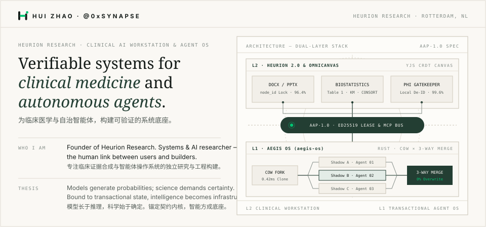
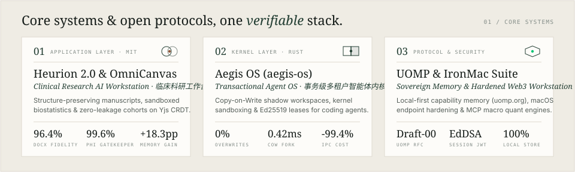
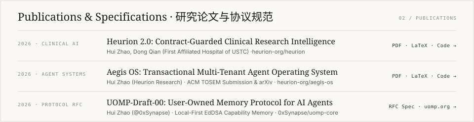

  
   
  
   
  

###### `01 / CORE SYSTEMS & REPOSITORIES`

- **01 · Heurion 2.0 & OmniCanvas** — *Clinical Research AI Workstation · 临床科研协同工作台*  
  [Enter Workstation (`heurion.org/app`) →](https://heurion.org/app) &nbsp;·&nbsp; [Official Site (`heurion.org`) →](https://heurion.org) &nbsp;·&nbsp; [GitHub (`heurion-org/heurion`) →](https://github.com/heurion-org/heurion)
- **02 · Aegis OS (`aegis-os`)** — *Transactional Multi-Tenant Agent Operating System · 事务级多租户智能体内核*  
  [GitHub (`heurion-org/aegis-os`) →](https://github.com/heurion-org/aegis-os) &nbsp;·&nbsp; [Benchmark Report →](https://github.com/heurion-org/aegis-os/blob/main/BENCHMARK_REPORT.md)
- **03 · UOMP (`uomp-core`)** — *User-Owned Memory Protocol · 用户主权本地记忆协议*  
  [Protocol Site (`uomp.org`) →](https://www.uomp.org) &nbsp;·&nbsp; [GitHub (`0xSynapse/uomp-core`) →](https://github.com/0xSynapse/uomp-core) &nbsp;·&nbsp; [RFC Draft-00 →](https://github.com/0xSynapse/uomp-core/blob/main/specs/draft-00.md)
- **04 · Systems & Security Tooling** — *Endpoint Hardening, Autonomous Quant & OS Bring-Up*  
  [IronMac (`0xSynapse/ironmac`) →](https://github.com/0xSynapse/ironmac) &nbsp;·&nbsp; [Crypto Strategy (`alphanalyzor.trade`) →](https://github.com/0xSynapse/crypto-strategy) &nbsp;·&nbsp; [StarkArk (`0xSynapse/stark-ark`) →](https://github.com/0xSynapse/stark-ark) &nbsp;·&nbsp; [OpenHarmony-Mac (`0xSynapse/openharmony-mac-build`) →](https://github.com/0xSynapse/openharmony-mac-build)

###### `02 / PUBLICATIONS`

- `2026 · CLINICAL AI` — **Heurion 2.0: Contract-Guarded Clinical Research Intelligence** (*Hui Zhao, Dong Qian*)  
  [PDF →](https://github.com/heurion-org/heurion/blob/main/paper/main.pdf) &nbsp;·&nbsp; [LaTeX →](https://github.com/heurion-org/heurion/blob/main/paper/main.tex) &nbsp;·&nbsp; [Benchmarks →](https://github.com/heurion-org/heurion/tree/main/paper/benchmarks)
- `2026 · AGENT SYSTEMS` — **Aegis OS: Transactional Multi-Tenant Agent Operating System** (*Hui Zhao*)  
  [PDF →](https://github.com/heurion-org/aegis-os/blob/main/paper/aegis_os_arxiv_preprint.pdf) &nbsp;·&nbsp; [LaTeX →](https://github.com/heurion-org/aegis-os/blob/main/paper/main.tex) &nbsp;·&nbsp; [TOSEM Package →](https://github.com/heurion-org/aegis-os/tree/main/paper/tosem)
- `2026 · PROTOCOL RFC` — **UOMP-Draft-00: User-Owned Memory Protocol for AI Agents** (*Hui Zhao*)  
  [RFC Spec →](https://github.com/0xSynapse/uomp-core/blob/main/specs/draft-00.md) &nbsp;·&nbsp; [English Spec →](https://github.com/0xSynapse/uomp/blob/main/src/content/spec/draft-00.en.md)

---

<b>HUI ZHAO (<code>@0xSynapse</code>) · HEURION RESEARCH</b> &nbsp;·&nbsp; <a href="https://heurion.org">heurion.org</a> &nbsp;·&nbsp; <a href="https://www.uomp.org">uomp.org</a> &nbsp;·&nbsp; <a href="https://github.com/heurion-org">github.com/heurion-org</a> &nbsp;·&nbsp; <a href="mailto:huizhao@heurion.org">huizhao@heurion.org</a>
