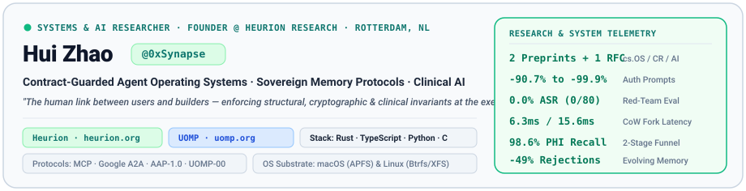
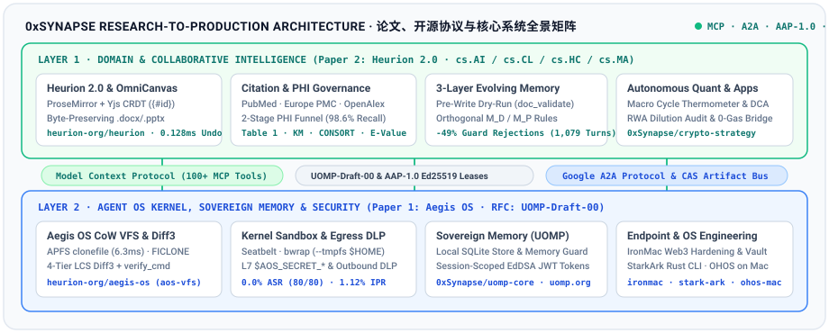

  

  
    
    
    
    
    
    

  
  <a href="#about--research-vision"><b>About & Research Vision</b></a> •  
  <a href="#publications--protocol-specifications"><b>Publications & RFCs</b></a> •  
  <a href="#research-to-production-ecosystem"><b>Ecosystem Architecture</b></a> •  
  <a href="#flagship-open-source-projects"><b>Open-Source Projects</b></a> •  
  <a href="#empirical-benchmarks"><b>Empirical Highlights</b></a> •  
  <a href="#中文概览-chinese-overview"><b>中文概览</b></a>  

---

##  About Me & Research Vision

I am **Hui Zhao (`@0xSynapse`)**, a **Systems & AI Researcher**, **Product Architect**, and **Founder of [Heurion Research](https://heurion.org)** based in Rotterdam, Netherlands. Acting as *"the human link between users and builders"*, my research and open-source engineering focus on **enforcing structural, cryptographic, and domain invariants at the execution boundary of autonomous AI agents**.

While modern large language model (LLM) agents excel at open-ended reasoning, deploying them in high-stakes environments—such as **autonomous software engineering**, **clinical & biomedical research**, and **sovereign personal computing**—exposes critical systems failures: severe human-in-the-loop authorization fatigue, unconfined shell/credential compromises, destructive formatting drift in scientific manuscripts, bibliographic hallucinations, and loss of user data sovereignty. My work addresses these challenges across four tightly coupled pillars:

<table>  
  <tr>  
    <td width="50%" valign="top">  
      <h3> 1. Transactional Agent Operating Systems</h3>  
      
Designing kernel-enforced OS runtimes (<a href="https://github.com/heurion-org/aegis-os"><b>Aegis OS</b></a>) that shift agent security from per-action confirmation prompts to <b>transactional Copy-on-Write (CoW) workspace boundaries</b> (<code>APFS clonefile</code> \&amp; Linux <code>Btrfs/XFS FICLONE</code>), paired with dual-tier kernel sandboxing (<code>Seatbelt</code> / <code>Bubblewrap</code>), L7 capability-scoped secret injection (<code>$AOS_SECRET\_*</code>), outbound DLP, and 4-Tier LCS Diff3 merge verification.
  
    </td>  
    <td width="50%" valign="top">  
      <h3> 2. Contract-Guarded Clinical AI \&amp; CRDT Studio</h3>  
      
Architecting <a href="https://github.com/heurion-org/heurion"><b>Heurion 2.0 \&amp; OmniCanvas</b></a>—a dual-surface clinical research workstation backed by a shared <b>ProseMirror + Yjs CRDT</b> core with stable block addressing (<code>{#id}</code>), sub-millisecond per-turn selective AI undo (<code>0.128 ms</code>), byte-preserving <code>.docx</code>/<code>.pptx</code> OOXML slice export, federated 4-database citation verification, a <b>Two-Stage PHI Funnel</b>, and a <b>Three-Layer Self-Evolving Memory System</b>.
  
    </td>  
  </tr>  
  <tr>  
    <td width="50%" valign="top">  
      <h3> 3. Sovereign Memory \&amp; Agent Protocols</h3>  
      
Authoring open specifications and reference implementations including the <a href="https://github.com/0xSynapse/uomp-core"><b>User-Owned Memory Protocol (UOMP)</b></a> and the <b>Aegis Application Protocol (<code>AAP-1.0</code>)</b>. UOMP keeps user memory local in SQLite and grants AI agents temporary, session-bound, tag/key-scoped access via short-lived <b>EdDSA JWT Capability Tokens</b>—eliminating centralized context hoarding.
  
    </td>  
    <td width="50%" valign="top">  
      <h3> 4. Endpoint Hardening, OS Bring-Up \&amp; Quant</h3>  
      
Building hardened macOS/Linux developer and Web3 infrastructure: <a href="https://github.com/0xSynapse/ironmac"><b>IronMac</b></a> (fortress-grade defense against macOS AMOS infostealers \&amp; blind signing), <a href="https://github.com/0xSynapse/crypto-strategy"><b>Crypto Strategy</b></a> (deterministic macro cycle \&amp; RWA dilution MCP engine), <a href="https://github.com/0xSynapse/stark-ark"><b>StarkArk</b></a> (Rust Starknet CLI/MCP wallet), and native <a href="https://github.com/0xSynapse/openharmony-mac-build"><b>OpenHarmony</b></a> kernel/system bring-up on Apple Silicon.
  
    </td>  
  </tr>  
</table>

---

##  Publications, Preprints & Protocol Specifications

Every research paper and protocol specification I author is paired with a **production-grade open-source implementation** and a **fully reproducible empirical benchmark suite**:

### 1. Operating Systems, Agent Security & Software Engineering (`cs.OS` · `cs.CR` · `cs.AI` · `cs.SE`)

>  **Aegis OS: A Transactional Multi-Tenant Operating System Runtime for Eliminating Authorization Fatigue in Autonomous Coding Agents**  
> **Hui Zhao** (*Heurion Research, Rotterdam, Netherlands*)  
> *arXiv Preprint & ACM Transactions on Software Engineering and Methodology (TOSEM) Submission, October 2026 · 19 Pages, 3 TikZ Figures, 13 Tables*  
> **Corresponding Project**: [**`heurion-org/aegis-os`**](https://github.com/heurion-org/aegis-os)  
> **Links**: [**Paper PDF (`aegis_os_arxiv_preprint.pdf`)**](https://github.com/heurion-org/aegis-os/blob/main/paper/aegis_os_arxiv_preprint.pdf) • [**LaTeX Source (`paper/main.tex`)**](https://github.com/heurion-org/aegis-os/blob/main/paper/main.tex) • [**ACM TOSEM Package (`paper/tosem`)**](https://github.com/heurion-org/aegis-os/tree/main/paper/tosem) • [**Reproducible Benchmark Suite (`BENCHMARK_REPORT.md`)**](https://github.com/heurion-org/aegis-os/blob/main/BENCHMARK_REPORT.md)
>
> - **Problem Addressed**: Autonomous coding agents (`agy`, `claude`, `codex`) face a *Security–Autonomy Dilemma*: per-action confirmation prompts interrupt 45%–57% of tool calls (and 39.0% of real shell commands use compound pipelines `&&`/`|` or inline scripts that defeat static prefix allowlists), whereas unconfined execution (`--yolo`) exposes host files and credentials to prompt injection and concurrent workspace clobbering.
> - **Core Contributions**: A 9-crate Rust Agent OS runtime exposed via 35 MCP tools and Google A2A that pairs millisecond CoW shadow workspaces (`APFS clonefile` / 7-syscall Linux `Btrfs FICLONE`), dual-tier kernel sandboxing (`sandbox-exec` / `bwrap` with default-deny `--tmpfs $HOME`), an identity-pinned L7 HTTP Egress Proxy with `$AOS_SECRET_*` boundary injection and outbound DLP, a 5-stage Cedar-inspired policy engine (`R0a`–`R4` with commit-time hook/CI poisoning guards), and a 2-Phase LCS Diff3 merge engine with sandboxed pre-commit semantic verification (`verify_cmd`).
> - **Key Empirical Results**: Across **28,087 tool calls from 52 real coding-agent sessions** and 1,500 controlled calls, Aegis OS reduces human confirmation prompts by **90.7%–97.9%** on real logs (lowering Interrupt Prompt Rate from `53.31%` to **`1.12%`**) and **94.19%–99.88%** on controlled trajectories; lowers Attack Success Rate across **80 live attacks** in 8 categories from **`100.0%` to `0.0%`** on both macOS and Linux (validated via a 9-row component necessity ablation); and forks a 1,000-file (`78.1 MB`) repository in **`6.3 ms`** on APFS (**`16×` faster** than `cp -cR` and **`20×` faster** than `git worktree add`) and **`15.6 ms`** on Linux Btrfs.

### 2. Clinical Research AI, Collaborative Systems & Self-Evolving Memory (`cs.AI` · `cs.CL` · `cs.HC` · `cs.MA`)

>  **Heurion 2.0: A Contract-Guarded Dual-Surface Architecture with Self-Evolving Memory for Citation-Grounded Clinical Research Authoring**  
> **Hui Zhao** (*Heurion Research*), **Dong Qian** (*Department of Radiation Oncology, The First Affiliated Hospital of USTC*)  
> *arXiv Preprint, October 2026*  
> **Corresponding Project**: [**`heurion-org/heurion`**](https://github.com/heurion-org/heurion) & [**`0xSynapse/heurion`**](https://github.com/0xSynapse/heurion) ([heurion.org](https://heurion.org))  
> **Links**: [**Paper PDF (`heurion/paper/main.pdf`)**](https://github.com/heurion-org/heurion/blob/main/paper/main.pdf) • [**LaTeX Source (`paper/main.tex`)**](https://github.com/heurion-org/heurion/blob/main/paper/main.tex) • [**Benchmark Suite (`paper/benchmarks`)**](https://github.com/heurion-org/heurion/tree/main/paper/benchmarks) • [**Live Clinical Workstation (`heurion.org/app`)**](https://heurion.org/app)
>
> - **Problem Addressed**: Free-form script-and-audit LLM agents corrupt Office Open XML (`.docx`/`.pptx`) formatting in scientific manuscripts, overwrite concurrent human edits, fabricate bibliographic identifiers (DOIs/PMIDs) and effect sizes, leak Protected Health Information (PHI), and repeat guard failures across multi-session workflows.
> - **Core Contributions**: (1) A **Dual-Surface CRDT Core** (`ProseMirror + Yjs`) with lifecycle-stable block IDs (`{#id}`), exposing a rich-text/slide studio to clinicians and a guarded Annotated Markdown projection to AI agents with character-level per-turn undo (`revertTurn`) and byte-preserving OOXML slice export; (2) **Pre-Write Citation & Claim Guards** across NCBI PubMed, Europe PMC, Crossref, and OpenAlex; (3) a **Two-Stage PHI De-Identification Funnel** (deterministic clinical checksums + local `qwen2.5:1.5b` NER) with formally verified Human–AI Permission Symmetry (`AAP-1.0`); and (4) a **Three-Layer Self-Evolving Memory System** separating human-confirmed declarative preferences ($M_D$) from utility-ranked procedural error-prevention rules ($M_P$).
> - **Key Empirical Results**: Achieves **`0.168 ms`** pre-write validation, **`0.351 ms`** guarded CRDT mutation, and **`0.128 ms`** selective per-turn AI rollback; preserves **100% byte identity** on untouched OOXML regions and resolves **100% (`9/9` vs. `0/9`, `p < 0.0001`)** of inline reviewer comments across 162 live LLM turns; attains **`98.6%` (`710/720`)** overall PHI recall (`100%` Stage-1 structured, `91.7%` Stage-2 narrative); and reduces guard rejections by **`-49%`** (`RR = 0.50`, Holm `p = 0.0269`) and total execution error signals by **`-37%`** (`RR = 0.63`, Holm `p = 0.0011`) across 1,079 live turns.

### 3. Open Protocol RFCs & Technical Standards

>  **UOMP-Draft-00: User-Owned Memory Protocol (UOMP) — Local-First Capability-Based Memory Authorization for AI Agents**  
> **Hui Zhao (`@0xSynapse`)**  
> *Public RFC Draft (`UOMP-Draft-00`), July 2026*  
> **Corresponding Projects**: [**`0xSynapse/uomp-core`**](https://github.com/0xSynapse/uomp-core) & [**`0xSynapse/uomp`**](https://github.com/0xSynapse/uomp) ([uomp.org](https://www.uomp.org))  
> **Links**: [**RFC Specification (`specs/draft-00.md`)**](https://github.com/0xSynapse/uomp-core/blob/main/specs/draft-00.md) • [**English Spec (`draft-00.en.md`)**](https://github.com/0xSynapse/uomp/blob/main/src/content/spec/draft-00.en.md) • [**On-Chain Audit Design**](https://github.com/0xSynapse/uomp-core/blob/main/docs/on-chain-audit-design.md) • [**Protocol Website (`uomp.org`)**](https://www.uomp.org)
>
> - **Specification Summary**: Defines a local-first, RFC 2119-compliant sovereign memory protocol where personal memory items reside in a user-controlled local SQLite store (`~/.uomp`). AI agents declare required memory scopes via `uom.json` and receive short-lived, session-bound **EdDSA-signed JWT Capability Tokens** enforced by a local `Memory Guard` (`127.0.0.1`), supporting tag/key scoping, aggregate queries without raw data exposure, instant session revocation, and cryptographic audit trails.

---

##  Research-to-Production Ecosystem Architecture

  
    

---

##  Open-Source Projects & Systems Portfolio

### A. Flagship Research Systems & Agent Protocols (With Corresponding Publications)

| Project & Repository                                                                                                                                                                                                                   | Research Paper / Spec                                                                                                                                                                             | Core Technical Architecture & Highlights                                                                                                                                                                                                                                                                                                                                                                                                                                             | Tech Stack                                                                              |
| :------------------------------------------------------------------------------------------------------------------------------------------------------------------------------------------------------------------------------------- | :------------------------------------------------------------------------------------------------------------------------------------------------------------------------------------------------ | :----------------------------------------------------------------------------------------------------------------------------------------------------------------------------------------------------------------------------------------------------------------------------------------------------------------------------------------------------------------------------------------------------------------------------------------------------------------------------------- | :-------------------------------------------------------------------------------------- |
| [**`heurion-org/heurion`**](https://github.com/heurion-org/heurion) ([`0xSynapse/heurion`](https://github.com/0xSynapse/heurion)) <b>Heurion 2.0 & OmniCanvas</b> · <a href="https://heurion.org">heurion.org</a> | [**Heurion 2.0 Preprint**](https://github.com/heurion-org/heurion/blob/main/paper/main.pdf) <code>cs.AI</code> · <code>cs.CL</code> · <code>cs.HC</code>                          | • **Dual-Surface CRDT Core**: `ProseMirror + Yjs` with stable `{#id}`, `0.128ms` per-turn AI rollback & byte-preserving `.docx`/`.pptx` export • **Citation & PHI Guards**: 4-way PubMed/PMC/OpenAlex verification + 2-Stage PHI Funnel (`98.6%` recall) • **3-Layer Evolving Memory**: Cuts guard rejections by **49%** across multi-turn clinical authoring • **OmniCanvas Studio**: Standalone Docs & 16:9 Slides studio with 30 Canvas MCP tools                  | `TypeScript` `Node.js 24` `ProseMirror` `Yjs` `Python 3.11` `Rust/WASM` `MCP` `AAP-1.0` |
| [**`heurion-org/aegis-os`**](https://github.com/heurion-org/aegis-os) <b>Aegis OS Runtime & Cloud PaaS</b>                                                                                                             | [**Aegis OS Preprint & TOSEM**](https://github.com/heurion-org/aegis-os/blob/main/paper/aegis_os_arxiv_preprint.pdf) <code>cs.OS</code> · <code>cs.CR</code> · <code>cs.SE</code> | • **Transactional CoW VFS (`aos-vfs`)**: `6.3ms` APFS `clonefile` & `15.6ms` Linux `FICLONE` shadow workspaces + 4-Tier LCS Diff3 & `verify_cmd` • **Dual-Tier Kernel Sandbox (`aos-sandbox`)**: Seatbelt & Bubblewrap (`--tmpfs $HOME`, `0.0%` ASR across 80 attacks) • **Zero-Trust Egress (`aos-egress`)**: L7 method/path `$AOS_SECRET_*` injection & outbound DLP • **A2A Bus & 5-Stage Policy**: 35 MCP tools, CAS bus (`-99.85%` IPC tokens) & **`1.12%` IPR** | `Rust` `APFS/Btrfs CoW` `Seatbelt` `Bubblewrap` `Ed25519` `MCP` `Google A2A`            |
| [**`0xSynapse/uomp-core`**](https://github.com/0xSynapse/uomp-core) ([`0xSynapse/uomp`](https://github.com/0xSynapse/uomp)) <b>User-Owned Memory Protocol</b> · <a href="https://www.uomp.org">uomp.org</a>       | [**UOMP-Draft-00 RFC**](https://github.com/0xSynapse/uomp-core/blob/main/specs/draft-00.md) Open Agent Memory Standard                                                            | • **Local-First Sovereign Store**: SQLite-backed personal memory (`~/.uomp`) with sensitivity & tag/key metadata • **Capability-Scoped Auth**: Short-lived EdDSA-signed JWT tokens bound to active agent sessions • **Memory Guard & SDK**: Local `127.0.0.1` enforcement proxy, `@uomp/sdk`, CLI authorizer & audit log                                                                                                                                                   | `TypeScript` `SQLite` `EdDSA JWT` `Astro` `CLI / SDK`                                   |

### B. Security Hardening, OS Kernel Bring-Up & Autonomous Quant/Web3 Systems

| Project & Repository                                                                                                                                                                                                    | Domain & Scope                                  | Key Capabilities & Engineering Highlights                                                                                                                                                                                                                                                                                                                                | Tech Stack                                                         |
| :---------------------------------------------------------------------------------------------------------------------------------------------------------------------------------------------------------------------- | :---------------------------------------------- | :----------------------------------------------------------------------------------------------------------------------------------------------------------------------------------------------------------------------------------------------------------------------------------------------------------------------------------------------------------------------- | :----------------------------------------------------------------- |
| [**`0xSynapse/ironmac`**](https://github.com/0xSynapse/ironmac) ([`homebrew-ironmac`](https://github.com/0xSynapse/homebrew-ironmac)) <b>IronMac Security Suite</b>                                | **macOS Endpoint Hardening & Web3 Vault**       | • Comprehensive macOS security posture audit (FileVault, SIP, Application Firewall, Stealth Mode, Gatekeeper) • Defense against macOS AMOS infostealers, plaintext shell key leakage, and blind-signing attacks • Hardware-isolated Keychain/Vault transaction preparation, calldata decoding, and MCP defense telemetry                                       | `Shell` `macOS Security` `Ruby (Homebrew)` `MCP` `EVM / Keccak256` |
| [**`0xSynapse/crypto-strategy`**](https://github.com/0xSynapse/crypto-strategy) <b>AI Macro Cycle & Dynamic DCA</b> · <a href="https://alphanalyzor.trade">alphanalyzor.trade</a>                       | **Quantitative Macro & Cross-Chain RWA Engine** | • Three-layer decoupled architecture: deterministic multi-factor quant engine + MCP Agent brain + non-custodial Web signing bridge • Real-time Crypto Macro Cycle Thermometer (`0–100`), US Treasury/RWA mapping, and token inflation/dilution penetration auditing • 0-Gas automated limit-order payloads (Fluxion DEX) and cross-chain RWA swap intents      | `TypeScript` `HTML/CSS` `Quant Models` `MCP Server` `DeFi / RWA`   |
| [**`0xSynapse/stark-ark`**](https://github.com/0xSynapse/stark-ark) <b>StarkArk v0.2.0</b>                                                                                                              | **AI-First Rust CLI/TUI Starknet Wallet**       | • Modular Rust CLI and interactive TUI wallet compatible with Starknet v10 RPC • Automation-native design with deterministic `--json` output and built-in **MCP Server** for autonomous agents • Multi-token portfolio scanner and AVNU DEX swap/staking integration                                                                                           | `Rust` `Starknet v10` `TUI / CLI` `MCP`                            |
| [**`0xSynapse/openharmony-mac-build`**](https://github.com/0xSynapse/openharmony-mac-build) <b>macOS-on-OHOS (`arm64_virt`)</b>                                                                         | **OS Build System & Apple Silicon Bring-Up**    | • Native compilation and boot of OpenHarmony (`arm64_virt`) on macOS Apple Silicon (`aarch64`) • Complete toolchain patches, Mach-O/glibc compatibility stubs, Mesa `swrast` EGL rendering, and Launcher/SystemUI bring-up                                                                                                                                          | `C / C++` `GN / Ninja` `OpenHarmony` `QEMU / virtio-gpu`           |
| [**`0xSynapse/ai-agent-wallet`**](https://github.com/0xSynapse/ai-agent-wallet) & [**`telegram-agent`**](https://github.com/0xSynapse/telegram-agent) & [**`beat-windows`**](https://github.com/0xSynapse/beat-windows) | **Agent Infrastructure & Creative Web Apps**    | • **`ai-agent-wallet`**: Backend-secured headless wallet framework with API key, JWT, and MFA guards • **`telegram-agent`**: Local AI agent that distills high-volume Telegram streams into an actionable task dashboard • **`beat-windows`** ([beatwindows.org](https://beatwindows.org/)): Interactive retro OS parody meme maker & pop-up smashing web game | `Python` `FastAPI` `HTML5 / Canvas` `Local LLM`                    |

---

##  Headline Empirical Benchmarks (From Published Preprints)

| Research System & Evaluation Dimension                        | Benchmark Scale & Methodology                                                          | Measured Result                                                                                                                                                           |
| :------------------------------------------------------------ | :------------------------------------------------------------------------------------- | :------------------------------------------------------------------------------------------------------------------------------------------------------------------------ |
| **Aegis OS · Real-World Coding-Agent Prompt Reduction**       | `28,087` tool calls across `52` production agent logs + `1,500` controlled calls       | **`90.7%–97.9%`** prompt reduction on real logs (Interrupt Prompt Rate reduced from `53.31%` to **`1.12%`**) & **`94.19%–99.88%`** on controlled trajectories             |
| **Aegis OS · End-to-End Adversarial Security & Ablation**     | `80` live attacks across `8` categories (`Cat. A–H`) + 9-row component ablation        | Attack Success Rate lowered from **`100.0%` (`Host-YOLO`)** and **`85.0% / 60.0%` (Native CLI Sandboxes)** to **`0.0%` (`0/80`)** on macOS & Linux                        |
| **Aegis OS · Zero-Copy CoW Workspace Provisioning**           | `1,000`-file (`78.1 MB`) repository across `10` concurrent coding agents               | **`6.28 ± 0.65 ms`** on macOS APFS (**`16×` faster** than `cp -cR`, **`20×` faster** than `git worktree add`) & **`15.6 ms`** on Linux Btrfs (`94.0%–97.5%` disk savings) |
| **Aegis OS · Multi-Agent Concurrency & CAS IPC Bus**          | `3` concurrent agents (`agy` + `claude` + `codex`) + syntactic/semantic conflict suite | **`100%` (`3/3`)** disjoint edit preservation, **`10/10`** syntactic & **`10/10`** semantic (`verify_cmd`) conflict interception, **`-99.85%`** IPC token overhead        |
| **Heurion 2.0 · Byte-Preserving OOXML & Reviewer Resolution** | `162` live LLM turns on `10` PubMed Central (`.docx`) clinical manuscripts             | **`0` vs. `4`** corrupted untouched paragraphs (`100%` byte identity); **`100%` (`9/9` vs. `0/9`, `p < 0.0001`)** inline reviewer comment resolution                      |
| **Heurion 2.0 · Two-Stage Clinical PHI De-Identification**    | `720` synthetic clinical PHI spans (`600` structured + `120` narrative)                | **`98.6%` (`710/720`)** overall recall (`100%` Stage-1 structured, `91.7%` Stage-2 narrative); **`0/30`** unconfirmed destructive clinical mutations                      |
| **Heurion 2.0 · Three-Layer Self-Evolving Memory Ablation**   | `1,079` live LLM turns across `8` seeds × `5` multi-turn authoring sessions            | **`-49%`** reduction in guard rejections (`RR = 0.50`, Holm `p = 0.0269`) and **`-37%`** reduction in total execution error signals (`RR = 0.63`, Holm `p = 0.0011`)      |

---

##  中文概览 (Chinese Overview)

### 1. 关于我 (About Me)

你好，我是 **Hui Zhao (`@0xSynapse`)**，系统与人工智能研究者、产品架构师，[**Heurion Research (`heurion.org`)**](https://heurion.org) 创始人（常驻荷兰鹿特丹）。我致力于成&#x4E3A;**“用户与构建者之间的桥梁（The human link between users and builders）”**，核心研究与工程方向聚焦于：**在自主智能体（Autonomous AI Agents）的执行边界强制实施结构性、密码学与领域安全不变量**，仅使用 macOS 与 Linux 构建高可靠系统。

### 2. 代表性论文与协议标准（Publications & Open Standards）

1. **[操作系统 / 智能体安全 / 软件工程] *Aegis OS: A Transactional Multi-Tenant Operating System Runtime for Eliminating Authorization Fatigue in Autonomous Coding Agents***
   - **作者**：Hui Zhao (*Heurion Research*) · *arXiv Preprint & ACM TOSEM 投稿论文 (2026)*
   - **对应开源项目**：[**`heurion-org/aegis-os`**](https://github.com/heurion-org/aegis-os) · [**论文 PDF**](https://github.com/heurion-org/aegis-os/blob/main/paper/aegis_os_arxiv_preprint.pdf) · [**实验报告 (`BENCHMARK_REPORT.md`)**](https://github.com/heurion-org/aegis-os/blob/main/BENCHMARK_REPORT.md)
   - **核心贡献**：将智能体安全边界从“单次工具调用弹窗”提升至“事务型工作区边界”。基于 Rust 实现毫秒级写时复制影子工作区（macOS APFS `clonefile` `6.3ms` / Linux Btrfs `FICLONE` `15.6ms`）、双层内核沙箱（Seatbelt / Bubblewrap `--tmpfs $HOME` 隔离）、L7 边界密钥注入与出站 DLP 防泄漏、五级策略引擎以及四级 LCS Diff3 + 编译语义门禁（`verify_cmd`）。在 **28,087 次真实编程智能体调用（52 个生产会话）**&#x4E2D;消除 **90.7%–97.9%** 的人工确认弹窗（打断率降至 **1.12%**），并在 80 项端到端对抗攻击测试中实现 **0.0%** 攻击成功率。
2. **[临床医学 AI / 协同系统 / 自演进记忆] *Heurion 2.0: A Contract-Guarded Dual-Surface Architecture with Self-Evolving Memory for Citation-Grounded Clinical Research Authoring***
   - **作者**：Hui Zhao (*Heurion Research*), Dong Qian (*中国科学技术大学附属第一医院放疗科*) · *arXiv Preprint (2026)*
   - **对应开源项目**：[**`heurion-org/heurion`**](https://github.com/heurion-org/heurion) / [**`0xSynapse/heurion`**](https://github.com/0xSynapse/heurion) ([heurion.org](https://heurion.org)) · [**论文 PDF**](https://github.com/heurion-org/heurion/blob/main/paper/main.pdf) · [**评测套件 (`paper/benchmarks`)**](https://github.com/heurion-org/heurion/tree/main/paper/benchmarks)
   - **核心贡献**：提出契约受控的双表面协同架构（底层基于 `ProseMirror + Yjs CRDT` 与稳定块寻址 `{#id}`，支持 `0.128ms` 按轮次精准回滚 AI 修改与 `.docx`/`.pptx` 原包切片级无损导出）、跨 PubMed / Europe PMC / Crossref / OpenAlex 四大权威数据库的前置文献核验、双阶段本地 PHI 隐私脱敏漏斗（**98.6%** 隐私召回率），以及声明式（$M_D$）与程序性（$M_P$）正交的三层自演进记忆系统（跨 1,079 轮实测将护栏拒绝率降低 **49%**，总错误信号降低 **37%**）。
3. **[开放协议草案] *UOMP-Draft-00: User-Owned Memory Protocol (用户主权记忆协议)***
   - **作者**：Hui Zhao (`@0xSynapse`) · *Public RFC Draft (2026)*
   - **对应开源项目**：[**`0xSynapse/uomp-core`**](https://github.com/0xSynapse/uomp-core) & [**`0xSynapse/uomp`**](https://github.com/0xSynapse/uomp) ([uomp.org](https://www.uomp.org)) · [**协议规范 (`specs/draft-00.md`)**](https://github.com/0xSynapse/uomp-core/blob/main/specs/draft-00.md)
   - **核心贡献**：定义 Local-First 的用户主权记忆授权协议，个人记忆数据持久化于本地 SQLite（`~/.uomp`），通过本地 `Memory Guard` 与会话级短期 EdDSA JWT Capability Token 向 AI Agent 授予最小化、可随时撤销、全链路可审计的临时记忆访问权。

### 3. 核心开源项目速览 (Core Open-Source Projects)

- **临床科研与智能体基础设施**：[**Heurion 2.0 & OmniCanvas (`heurion-org/heurion`)**](https://github.com/heurion-org/heurion) • [**Aegis OS (`heurion-org/aegis-os`)**](https://github.com/heurion-org/aegis-os) • [**UOMP (`0xSynapse/uomp-core`)**](https://github.com/0xSynapse/uomp-core)
- **终端安全、系统移植与量化/Web3 工具链**：[**IronMac (`0xSynapse/ironmac`)**](https://github.com/0xSynapse/ironmac)（macOS 堡垒级 Web3 安全审计与防窃密套件）• [**Crypto Strategy (`0xSynapse/crypto-strategy`)**](https://github.com/0xSynapse/crypto-strategy)（[alphanalyzor.trade](https://alphanalyzor.trade)，多因子周期温度计与 MCP 动态定投引擎）• [**StarkArk (`0xSynapse/stark-ark`)**](https://github.com/0xSynapse/stark-ark)（Rust Starknet v10 CLI/MCP 钱包）• [**OpenHarmony macOS Build (`0xSynapse/openharmony-mac-build`)**](https://github.com/0xSynapse/openharmony-mac-build)（Apple Silicon 原生构建与启动 OpenHarmony `arm64_virt`）• [**Beat Windows (`0xSynapse/beat-windows`)**](https://github.com/0xSynapse/beat-windows)（[beatwindows.org](https://beatwindows.org)）

---

 <b>Hui Zhao (<code>@0xSynapse</code>) · Heurion Research</b>  
   <b>Websites</b>: <a href="https://heurion.org">heurion.org</a> · <a href="https://www.uomp.org">uomp.org</a> · <a href="https://alphanalyzor.trade">alphanalyzor.trade</a> · <a href="https://beatwindows.org">beatwindows.org</a>  
   <b>GitHub Organizations & Profiles</b>: <a href="https://github.com/0xSynapse">@0xSynapse</a> · <a href="https://github.com/heurion-org">@heurion-org</a> · <b>Email</b>: <a href="mailto:huizhao@heurion.org"><huizhao@heurion.org></a>

